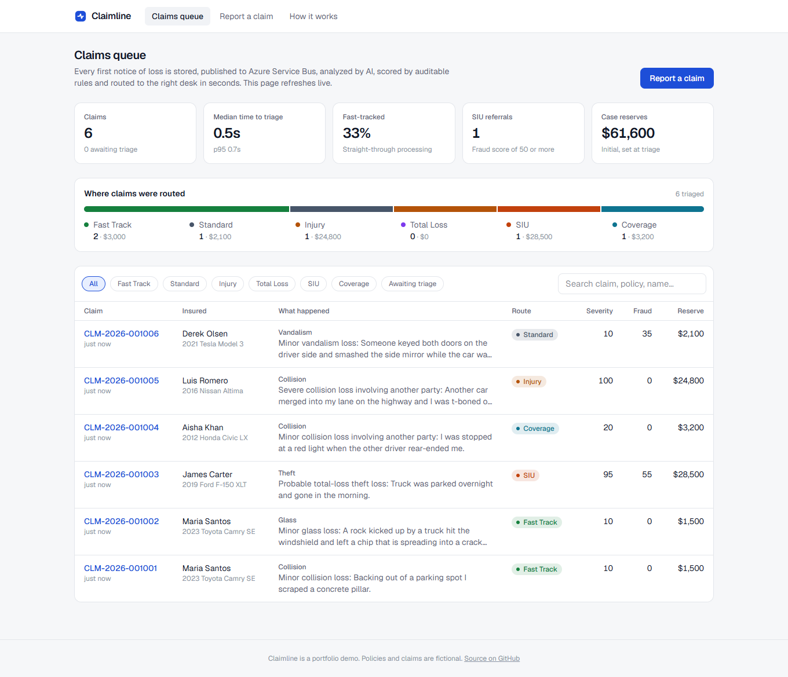
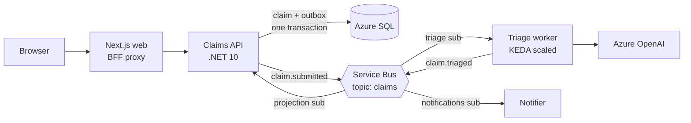
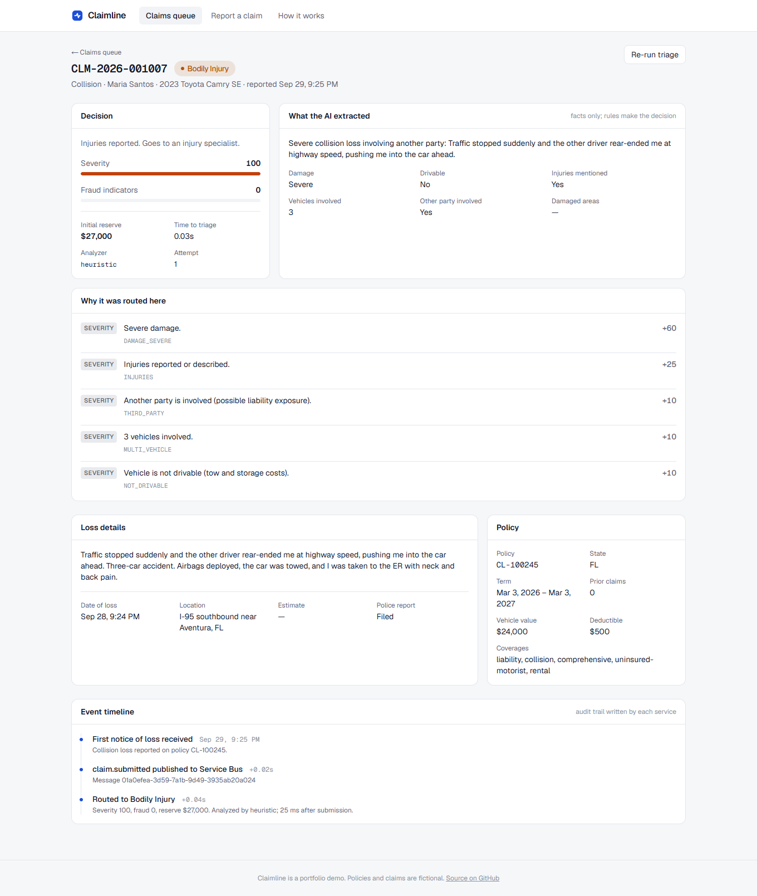

# Claimline

**Event-driven auto-insurance claims intake and AI triage on Azure.**
A policyholder reports a loss. In about a second the claim is stored, published to Azure Service Bus, analyzed by Azure OpenAI, scored by an auditable rules engine and routed to the right desk: Fast Track, Standard, Bodily Injury, Total Loss, Special Investigations (SIU) or Coverage Review.

[](https://github.com/Adrielcodes/claimline/actions/workflows/ci.yml)




## Why this exists

First notice of loss (FNOL) is where a claim's cost is decided. A minor windshield chip and a highway crash with injuries arrive through the same form, and a carrier that routes them by hand pays for it in handling time, leakage and slow payouts. Claimline automates that first decision the way a real carrier platform would:

- **Nothing is lost.** A claim is durable the moment the API returns `202 Accepted`, even if the messaging, AI or worker tier is down.
- **Decisions are explainable.** The model only extracts facts. Routing, fraud scores and reserves come from deterministic rules, and every point is shown with its reason.
- **It runs like production.** Managed identity everywhere, infrastructure as code, distributed tracing, scale-to-zero workers and keyless CI/CD.

## Architecture



| Service | Responsibility |
| --- | --- |
| `Claimline.Api` | FNOL intake, claim read model, transactional outbox, idempotent `claim.triaged` projection, OpenAPI docs |
| `Claimline.Worker` | Stateless consumers: AI analysis + rules → `claim.triaged`; policyholder notifications |
| `Claimline.Triage` | Pure domain logic: rules engine, heuristic and Azure OpenAI analyzers, fallback policy |
| `Claimline.Contracts` | Event contracts and topology shared by every service |
| `Claimline.ServiceDefaults` | Service Bus consumer base class, publisher, OpenTelemetry setup |
| `web` | Next.js 16 adjuster queue, FNOL form, claim detail with live event timeline |

## Engineering highlights

| Problem | How Claimline handles it |
| --- | --- |
| Dual write: saving a claim *and* publishing its event can half-fail | **Transactional outbox.** Both rows commit in one SQL transaction; a dispatcher relays with `UPDLOCK, READPAST` so API replicas never double-send. [ADR 0001](docs/adr/0001-transactional-outbox.md) |
| At-least-once delivery means duplicates | **Idempotent consumers.** An inbox table commits with the side effects. The worker derives outgoing message ids from incoming ones, so Service Bus duplicate detection drops repeats. |
| A double-clicked submit or a client retry | **`Idempotency-Key` header** backed by a filtered unique index, which is race-safe under concurrency. |
| A slow result from an old attempt arrives after a re-triage | **Attempt numbers.** Stale results are logged to the timeline and ignored. |
| LLMs are non-deterministic and can be down | **AI extracts, rules decide.** Strict JSON-schema structured output, a timeout, and fallback to a heuristic analyzer. [ADR 0002](docs/adr/0002-ai-extracts-rules-decide.md) |
| Poison messages | Permanent failures are dead-lettered immediately with a reason. Transient ones are retried up to `MaxDeliveryCount`. |
| Secrets sprawl | **None exist.** One user-assigned managed identity with RBAC on Service Bus (local auth disabled), Azure SQL (Entra-only), Azure OpenAI (keys disabled) and ACR. [ADR 0003](docs/adr/0003-managed-identity-zero-secrets.md) |
| Cost at idle | Worker scales to zero on Service Bus backlog (KEDA). Azure SQL serverless free offer auto-pauses, with EF Core retry for resume. [ADR 0004](docs/adr/0004-container-apps.md) |
| "Where did this claim get stuck?" | One distributed trace per claim across HTTP → outbox → topic → worker → topic → API (OpenTelemetry → Application Insights / Aspire dashboard). |



## Run it locally

Requires Docker Desktop.

```bash
docker compose up --build
```

| URL | What |
| --- | --- |
| http://localhost:3100 | Web app (queue, report a claim, how it works) |
| http://localhost:5080/scalar | Interactive API docs |
| http://localhost:18888 | Aspire dashboard: traces, metrics and logs from every service |

The stack runs SQL Server 2022 and the official **Azure Service Bus emulator**, configured with the same topic, subscriptions and filters as Azure ([`deploy/servicebus-emulator.json`](deploy/servicebus-emulator.json)). Six demo policies and sample claims are seeded; each policy sets up a different triage scenario.

Without an Azure OpenAI endpoint the worker uses its heuristic analyzer, so everything works offline.

### Inner loop

```bash
docker compose up sqlserver servicebus dashboard   # infrastructure only
dotnet run --project src/Claimline.Api             # http://localhost:5080
dotnet run --project src/Claimline.Worker
cd web && npm install && npm run dev               # http://localhost:3000
```

### Tests

```bash
dotnet test --solution Claimline.slnx
```

38 tests: rules-engine and analyzer unit tests, plus API integration tests that run against a real SQL Server in **Testcontainers**. They cover the outbox, idempotency keys, inbox de-duplication, stale-result handling and validation.

## Deploy to Azure

`infra/` contains the Bicep templates and `.github/workflows/deploy.yml` deploys on every push to `main` through OIDC workload identity federation (no stored credentials). One-time setup and cost notes are in [docs/deploy.md](docs/deploy.md).

Provisioned: Container Apps environment (api, worker, web), Container Registry, Service Bus Standard, Azure SQL serverless, Azure OpenAI, Log Analytics + Application Insights, and a user-assigned managed identity with role assignments.

## Project layout

```
src/
  Claimline.Api/            ASP.NET Core minimal API, EF Core, outbox dispatcher, projection consumer
  Claimline.Worker/         triage + notification consumers
  Claimline.Triage/         rules engine and analyzers (no infrastructure dependencies)
  Claimline.Contracts/      events and Service Bus topology
  Claimline.ServiceDefaults/ messaging and telemetry plumbing
tests/                      xUnit v3 unit and Testcontainers integration tests
web/                        Next.js 16 frontend
infra/                      Bicep (registry.bicep, main.bicep)
deploy/                     Service Bus emulator topology
docs/                       ADRs, deployment guide, screenshots
```

## What I'd build next

- Entra ID sign-in for adjusters with role-based access to SIU claims
- Document intake: photos and police reports through Azure AI Document Intelligence
- Private networking (VNet-integrated Container Apps, private endpoints for SQL and Service Bus)
- A replay tool for dead-lettered messages, and a load test to tune KEDA thresholds

---

Built by [Adriel Ramirez](https://github.com/Adrielcodes). Policies, people and claims in this project are fictional.
